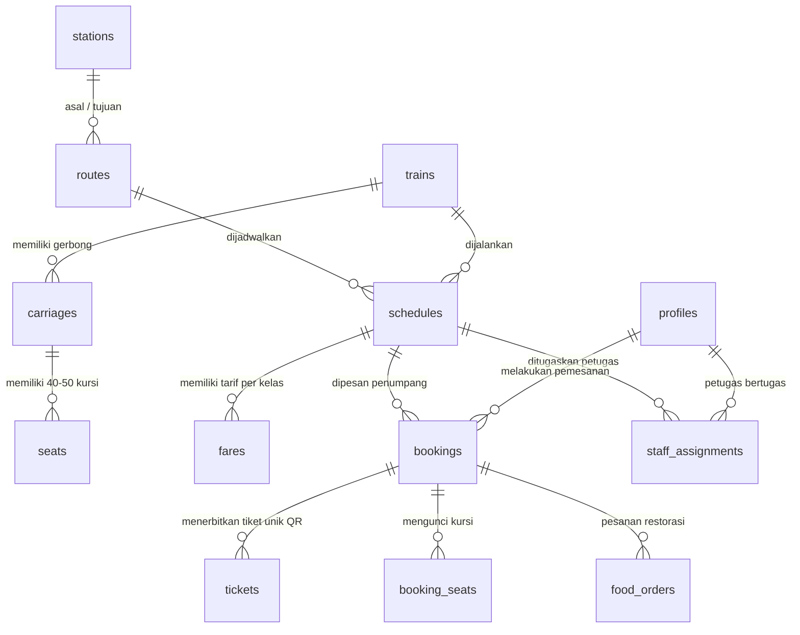

# 🚆 RAILHUB — Dokumentasi Data Operasional (DATA.md)

Dokumen ini berisi rangkuman **seluruh data nyata (*curated operational data*)** yang diimplementasikan dan digunakan secara aktif di website **RAILHUB Indonesia** (`https://railhub-indonesia.vercel.app`), disaring langsung dari sumber data mentah (*raw data*) stasiun, jadwal KAI, dan migrasi Supabase untuk keperluan presentasi & pengujian UAS Pemrograman Web Kelompok 14.

---

## 📌 Daftar Isi
1. [Katalog 50 Stasiun Operasional](#1-katalog-50-stasiun-operasional)
2. [Armada Kereta Api & Kelas Layanan](#2-armada-kereta-api--kelas-layanan)
3. [Jadwal & Koridor Perjalanan Utama](#3-jadwal--koridor-perjalanan-utama)
4. [Katalog Layanan Kuliner Restorasi Onboard](#4-katalog-layanan-kuliner-restorasi-onboard)
5. [Akun Demo & Role Pengujian UAS](#5-akun-demo--role-pengujian-uas)
6. [Struktur Relasi Database Supabase](#6-struktur-relasi-database-supabase)

---

## 1. Katalog 50 Stasiun Operasional

Sumber: `stationsCatalog.js` & `202611010007_expand_station_catalog.sql`  
Data stasiun aktif yang dapat dicari dan dipilih pada formulir tiket, pencarian rute, live map tracker, dan database:

| No | Kode | Nama Stasiun | Kota / Kabupaten | Provinsi | Kategori | Hub Operasional |
|:--:|:----:|:-------------|:-----------------|:---------|:---------|:---------------:|
| 1 | **GMR** | Gambir | Jakarta Pusat | DKI Jakarta | Intercity Premier | GMR |
| 2 | **PSE** | Pasar Senen | Jakarta Pusat | DKI Jakarta | Intercity Utama | PSE |
| 3 | **JNG** | Jatinegara | Jakarta Timur | DKI Jakarta | Intercity Transit | PSE |
| 4 | **MRI** | Manggarai | Jakarta Selatan | DKI Jakarta | Transit Central Hub | GMR |
| 5 | **JAKK**| Jakarta Kota | Jakarta Barat | DKI Jakarta | Heritage Terminal | GMR |
| 6 | **BD** | Bandung | Kota Bandung | Jawa Barat | Intercity Utama | BD |
| 7 | **KAC** | Kiaracondong | Kota Bandung | Jawa Barat | Intercity Ekonomi | BD |
| 8 | **CN** | Cirebon | Kota Cirebon | Jawa Barat | Intercity Hub | CN |
| 9 | **CNP** | Cirebon Prujakan | Kota Cirebon | Jawa Barat | Intercity Ekonomi | CN |
| 10 | **BJR** | Banjar | Kota Banjar | Jawa Barat | Regional Jalur Selatan | BD |
| 11 | **CI** | Ciamis | Kabupaten Ciamis | Jawa Barat | Regional | BD |
| 12 | **TSM** | Tasikmalaya | Kota Tasikmalaya | Jawa Barat | Intercity | BD |
| 13 | **CKP** | Cikampek | Kabupaten Karawang | Jawa Barat | Percabangan Pantura/Selatan | GMR |
| 14 | **BOP** | Bogor Paledang | Kota Bogor | Jawa Barat | Regional Pangrango | GMR |
| 15 | **BTT** | Batutulis | Kota Bogor | Jawa Barat | Regional | GMR |
| 16 | **CBD** | Cibadak | Kabupaten Sukabumi | Jawa Barat | Regional | BD |
| 17 | **CB** | Cibatu | Kabupaten Garut | Jawa Barat | Junction Garut | BD |
| 18 | **CCL** | Cicalengka | Kabupaten Bandung | Jawa Barat | Commuter Line Timur | BD |
| 19 | **CCR** | Cicurug | Kabupaten Sukabumi | Jawa Barat | Regional | GMR |
| 20 | **AWN** | Arjawinangun | Kabupaten Cirebon | Jawa Barat | Regional | CN |
| 21 | **SMT** | Semarang Tawang | Kota Semarang | Jawa Tengah | Intercity Pantura | SMT |
| 22 | **SMC** | Semarang Poncol | Kota Semarang | Jawa Tengah | Intercity Ekonomi | SMT |
| 23 | **SLO** | Solo Balapan | Kota Surakarta | Jawa Tengah | Intercity Utama | SLO |
| 24 | **PWT** | Purwokerto | Kabupaten Banyumas | Jawa Tengah | Intercity Hub Prupuk | PWT |
| 25 | **CP** | Cilacap | Kabupaten Cilacap | Jawa Tengah | Terminal Percabangan | PWT |
| 26 | **KTA** | Kutoarjo | Kabupaten Purworejo | Jawa Tengah | Intercity Selatan | YK |
| 27 | **TGL** | Tegal | Kota Tegal | Jawa Tengah | Intercity Pantura | SMT |
| 28 | **PK** | Pekalongan | Kota Pekalongan | Jawa Tengah | Intercity Pantura | SMT |
| 29 | **BB** | Brebes | Kabupaten Brebes | Jawa Tengah | Regional Pantura | SMT |
| 30 | **BMA** | Bumiayu | Kabupaten Brebes | Jawa Tengah | Regional Jalur Tengah | PWT |
| 31 | **BTG** | Batang | Kabupaten Batang | Jawa Tengah | Regional Pantai Utara | SMT |
| 32 | **CO** | Comal | Kabupaten Pemalang | Jawa Tengah | Regional | SMT |
| 33 | **DPL** | Doplang | Kabupaten Blora | Jawa Tengah | Regional | SMT |
| 34 | **GBN** | Gambringan | Kabupaten Grobogan | Jawa Tengah | Percabangan Gundih | SMT |
| 35 | **GB** | Gombong | Kabupaten Kebumen | Jawa Tengah | Intercity Jalur Selatan | PWT |
| 36 | **GD** | Gundih | Kabupaten Grobogan | Jawa Tengah | Junction Solo-Semarang | SLO |
| 37 | **YK** | Yogyakarta (Tugu) | Kota Yogyakarta | DI Yogyakarta | Intercity Premier | YK |
| 38 | **LPN** | Lempuyangan | Kota Yogyakarta | DI Yogyakarta | Intercity Ekonomi | YK |
| 39 | **WT** | Wates | Kabupaten Kulon Progo | DI Yogyakarta | Regional Bandara YIA | YK |
| 40 | **SGU** | Surabaya Gubeng | Kota Surabaya | Jawa Timur | Intercity Utama Gubeng | SGU |
| 41 | **SBI** | Surabaya Pasarturi | Kota Surabaya | Jawa Timur | Intercity Pantura Utama | SGU |
| 42 | **WO** | Wonokromo | Kota Surabaya | Jawa Timur | Regional Transit | SGU |
| 43 | **ML** | Malang | Kota Malang | Jawa Timur | Intercity Terminal Kotabaru | ML |
| 44 | **MLK** | Malang Kotalama | Kota Malang | Jawa Timur | Intercity | ML |
| 45 | **MN** | Madiun | Kota Madiun | Jawa Timur | Intercity PT INKA Hub | MN |
| 46 | **BL** | Blitar | Kota Blitar | Jawa Timur | Intercity Jalur Kantong | ML |
| 47 | **KD** | Kediri | Kota Kediri | Jawa Timur | Intercity | KD |
| 48 | **JG** | Jombang | Kabupaten Jombang | Jawa Timur | Intercity | SGU |
| 49 | **KTS** | Kertosono | Kabupaten Nganjuk | Jawa Timur | Percabangan Kertosono | MN |
| 50 | **JR** | Jember | Kabupaten Jember | Jawa Timur | Intercity Daop 9 | JR |

---

## 2. Armada Kereta Api & Kelas Layanan

Sumber: `schedulesEngine.js` & `202610310001_search_train_schedules.sql`

### A. Daftar Kereta Api Aktif
| Nama Kereta | Nomor KA | Layanan Rute Khas | Tipe Rangkaian |
|:------------|:--------:|:------------------|:---------------|
| **Argo Parahyangan** | KA 34 / KA 36 | Gambir (GMR) — Bandung (BD) | Eksekutif & Panoramic |
| **Argo Bromo Anggrek** | KA 1 / KA 3 | Gambir (GMR) — Surabaya Pasarturi (SBI/SGU) | Luxury Sleeper & Eksekutif New Gen |
| **Taksaka (Pagi/Malam)** | KA 68 / KA 70 | Gambir (GMR) — Yogyakarta (YK) | Hype Trip Eksekutif |
| **Argo Dwipangga** | KA 10 | Gambir (GMR) — Solo Balapan (SLO) | Eksekutif New Generation Stainless |
| **Argo Lawu** | KA 8 | Gambir (GMR) — Solo Balapan (SLO) | Eksekutif New Generation Stainless |
| **Argo Wilis** | KA 6 | Bandung (BD) — Surabaya Gubeng (SGU) | Eksekutif Panorama Lintas Selatan |
| **Turangga** | KA 66 | Bandung (BD) — Surabaya Gubeng (SGU) | Eksekutif Night Express |
| **Sembrani** | KA 64 | Gambir (GMR) — Surabaya Pasarturi (SBI) | Eksekutif & Luxury |
| **Bima** | KA 60 | Gambir (GMR) — Surabaya Gubeng (SGU) | Eksekutif Klasik |
| **Jayakarta** | KA 218 | Pasar Senen (PSE) — Surabaya Gubeng (SGU) | Ekonomi Premium 2-2 |
| **Gaya Baru Malam Selatan** | KA 106 | Pasar Senen (PSE) — Surabaya Gubeng (SGU) | Eksekutif & Ekonomi |
| **Jayabaya** | KA 108 | Pasar Senen (PSE) — Malang (ML) via Pantura | Eksekutif & Ekonomi |
| **Airlangga** | KA 236 | Pasar Senen (PSE) — Surabaya Pasarturi (SBI) | Ekonomi Terjangkau (PSO) |
| **Kertajaya** | KA 220 | Pasar Senen (PSE) — Surabaya Pasarturi (SBI) | Ekonomi Rangkaian Panjang (14 Gerbong) |
| **Lodaya** | KA 92 | Bandung (BD) — Solo Balapan (SLO) | Eksekutif & Ekonomi |
| **Malabar** | KA 122 | Bandung (BD) — Malang (ML) | Eksekutif, Bisnis & Ekonomi |
| **Sancaka** | KA 176 | Yogyakarta (YK) — Surabaya Gubeng (SGU) | Eksekutif & Ekonomi |

### B. Fasilitas per Kelas Kereta
- **Luxury Sleeper**: Kursi rebah 140°, layar VOD pribadi, USB & fast-charging, selimut tebal, makanan berat & dessert gratis.
- **Eksekutif**: Captain Seat 2-2 putar dan rebah, meja kerja lipat, AC dingin terpusat, stopkontak ganda per baris, WiFi onboard.
- **Bisnis**: Formasi 2-2 reclining seat, stopkontak, kabin bebas asap rokok, akses restorasi.
- **Ekonomi New Generation**: Kursi 2-2 tidak berhadapan, ruang kaki lega, reclining seat ergonomis, stopkontak dinding.

---

## 3. Jadwal & Koridor Perjalanan Utama

Sumber: `schedulesEngine.js` & database `schedules`

### 1. Koridor Jakarta (PSE) — Surabaya Gubeng (SGU)
| KA & Nomor | Jam Berangkat | Jam Tiba | Durasi Nyata | Kelas | Sub | Tarif Tiket | Kursi |
|:-----------|:-------------:|:--------:|:------------:|:------|:---:|:-----------:|:-----:|
| **Jayakarta (KA 218)** | 17:10 WIB | 06:01 WIB (+1) | 12 Jam 51 Menit | Ekonomi | CA | Rp 430.000 | 24 |
| **Gaya Baru Malam (KA 106)** | 11:10 WIB | 23:35 WIB | 12 Jam 25 Menit | Ekonomi | CA | Rp 460.000 | 18 |
| **Jayabaya (KA 108)** | 22:15 WIB | 08:33 WIB (+1) | 10 Jam 18 Menit | Ekonomi | CD | Rp 500.000 | 12 |
| **Airlangga (KA 236)** | 11:20 WIB | 23:05 WIB | 11 Jam 45 Menit | Ekonomi | C | Rp 104.000 | 8 |
| **Kertajaya (KA 220)** | 14:30 WIB | 01:25 WIB (+1) | 10 Jam 55 Menit | Ekonomi | CA | Rp 310.000 | 32 |

### 2. Koridor Jakarta (GMR) — Surabaya Gubeng/Pasarturi (SGU/SBI)
| KA & Nomor | Jam Berangkat | Jam Tiba | Durasi Nyata | Kelas | Sub | Tarif Tiket | Kursi |
|:-----------|:-------------:|:--------:|:------------:|:------|:---:|:-----------:|:-----:|
| **Argo Bromo Anggrek (KA 1)** | 08:20 WIB | 16:30 WIB | 8 Jam 10 Menit | Eksekutif | AA | Rp 650.000 | 38 |
| **Argo Bromo Malam (KA 3)** | 20:30 WIB | 04:40 WIB (+1) | 8 Jam 10 Menit | Eksekutif | AA | Rp 670.000 | 20 |
| **Sembrani (KA 64)** | 19:30 WIB | 04:00 WIB (+1) | 8 Jam 30 Menit | Eksekutif | AA | Rp 620.000 | 28 |
| **Bima (KA 60)** | 17:00 WIB | 03:30 WIB (+1) | 10 Jam 30 Menit | Eksekutif | AA | Rp 590.000 | 19 |
| **Argo Semeru (KA 18)** | 06:20 WIB | 16:50 WIB | 10 Jam 30 Menit | Eksekutif | A | Rp 580.000 | 25 |

### 3. Koridor Jakarta (GMR) — Yogyakarta (YK)
| KA & Nomor | Jam Berangkat | Jam Tiba | Durasi Nyata | Kelas | Sub | Tarif Tiket | Kursi |
|:-----------|:-------------:|:--------:|:------------:|:------|:---:|:-----------:|:-----:|
| **Taksaka Pagi (KA 68)** | 09:20 WIB | 15:30 WIB | 6 Jam 10 Menit | Eksekutif | AA | Rp 550.000 | 34 |
| **Taksaka Malam (KA 70)** | 21:40 WIB | 03:50 WIB (+1) | 6 Jam 10 Menit | Eksekutif | AA | Rp 560.000 | 26 |
| **Argo Dwipangga (KA 10)** | 08:50 WIB | 14:55 WIB | 6 Jam 05 Menit | Eksekutif | AA | Rp 580.000 | 22 |
| **Argo Lawu (KA 8)** | 20:45 WIB | 02:50 WIB (+1) | 6 Jam 05 Menit | Eksekutif | AA | Rp 580.000 | 17 |

### 4. Koridor Bandung (BD) — Surabaya Gubeng (SGU)
| KA & Nomor | Jam Berangkat | Jam Tiba | Durasi Nyata | Kelas | Sub | Tarif Tiket | Kursi |
|:-----------|:-------------:|:--------:|:------------:|:------|:---:|:-----------:|:-----:|
| **Argo Wilis (KA 6)** | 07:45 WIB | 17:35 WIB | 9 Jam 50 Menit | Eksekutif | AA | Rp 600.000 | 31 |
| **Turangga (KA 66)** | 18:10 WIB | 04:20 WIB (+1) | 10 Jam 10 Menit | Eksekutif | AA | Rp 580.000 | 27 |
| **Pasundan (KA 240)** | 10:10 WIB | 23:54 WIB | 13 Jam 44 Menit | Ekonomi | CA | Rp 280.000 | 14 |
| **Mutiara Selatan (KA 86)** | 20:00 WIB | 07:08 WIB (+1) | 11 Jam 08 Menit | Eksekutif | AA | Rp 520.000 | 15 |
| **Mutiara Selatan (KA 86)** | 20:00 WIB | 07:08 WIB (+1) | 11 Jam 08 Menit | Ekonomi | CA | Rp 360.000 | 22 |

---

## 4. Katalog Layanan Kuliner Restorasi Onboard

Sumber: `202610310004_passenger_services.sql` & `orders/page.js`

| Kategori | SKU Produk | Nama Menu | Deskripsi Layanan | Harga |
|:---------|:----------:|:----------|:------------------|:-----:|
| **Makanan** | `RH-MEAL-001` | Nasi Ayam Rempah Nusantara | Nasi hangat pulen, ayam ungkep goreng rempah, lalapan, & sambal terasi. | Rp 35.000 |
| **Makanan** | `RH-MEAL-002` | Nasi Rendang Sapi Parahyangan | Rendang daging sapi bumbu minang otentik, daun singkong, & nasi hangat. | Rp 42.000 |
| **Makanan** | `RH-MEAL-003` | Mi Goreng Spesial Onboard | Mi goreng lezat khas kereta api dengan telur orak-arik dan sayuran segar. | Rp 28.000 |
| **Minuman** | `RH-DRINK-001`| Air Mineral Botol (600 ml) | Air mineral higienis dingin / suhu ruang. | Rp 8.000 |
| **Minuman** | `RH-DRINK-002`| Teh Tarik / Teh Manis Hangat | Seduhan teh melati wangi dengan gula pasir asli disajikan panas. | Rp 10.000 |
| **Camilan** | `RH-SNACK-001`| Roti Isi Aneka Rasa | Roti manis lembut dengan pilihan selai cokelat, keju, atau srikaya. | Rp 15.000 |

---

## 5. Role Pengujian UAS

Akun pengujian dapat diakses langsung melalui fitur **1-Click Login Cepat** pada halaman login (`/auth/login`):

| Role Pengujian | Akun & Armada | Destinasi Redirect | Hak Akses Utama |
|:---------------|:--------------|:-------------------|:----------------|
| **👤 Penumpang** | `penumpang.demo@railhub.id` | `/dashboard/passenger` | Cari jadwal, pilih kursi, bayar tiket simulasi, lacak perjalanan, pesan makanan, refund/reschedule. |
| **🚆 Petugas KA Argo Bromo** | `petugas.argobromo@railhub.id` (KA 1) | `/dashboard/staff` | Validasi tiket digital QR boarding pass, manifest penumpang, update status perjalanan (Departed/Arrived), & pesanan makanan. |
| **🚆 Petugas KA Taksaka** | `petugas.taksaka@railhub.id` (KA 68) | `/dashboard/staff` | Validasi tiket digital QR boarding pass, manifest penumpang, update status perjalanan, & pesanan restorasi. |
| **🚆 Petugas KA Argo Parahyangan** | `petugas.parahyangan@railhub.id` (KA 34) | `/dashboard/staff` | Validasi tiket digital QR boarding pass, manifest penumpang, update status perjalanan, & pesanan restorasi. |
| **🚆 Petugas KA Argo Wilis** | `petugas.argowilis@railhub.id` (KA 6) | `/dashboard/staff` | Validasi tiket digital QR boarding pass, manifest penumpang, update status perjalanan, & pesanan restorasi. |
| **🚆 Petugas KA Turangga** | `petugas.turangga@railhub.id` (KA 66) | `/dashboard/staff` | Validasi tiket digital QR boarding pass, manifest penumpang, update status perjalanan, & pesanan restorasi. |
| **🛡️ Administrator** | `admin.operasional@railhub.id` | `/dashboard/admin` | Kelola master data stasiun, kereta, gerbong, kursi, rute, jadwal, tarif, penugasan petugas, dan rekap pemesanan. |

---

## 6. Struktur Relasi Database Supabase

Sumber: `supabase/migrations/` (PostgreSQL RLS Enabled)

### Rekap Tabel Utama:
1. `public.stations`: Menyimpan 50 data stasiun (kode stasiun 2-4 digit, nama, kota, koordinat).
2. `public.trains`: Master data kereta api, nomor KA, dan kelas pelayanan.
3. `public.carriages` & `public.seats`: Rangkaian gerbong dan nomor kursi (A-D, 1-10) terkunci per perjalanan agar tidak *double booking*.
4. `public.schedules`: Jadwal keberangkatan, kedatangan, status (*scheduled, departed, arrived, cancelled*).
5. `public.fares`: Tarif rupiah resmi berdasarkan relasi jadwal dan kelas kereta.
6. `public.bookings` & `public.booking_seats`: Transaksi pemesanan berstatus *pending* (hold 15 menit), *paid*, atau *cancelled*.
7. `public.tickets`: Nomor tiket unik dengan enkripsi QR Code untuk pemindaian petugas gerbang dan kondektur.
8. `public.staff_assignments`: Menghubungkan ID akun petugas (gerbang/kondektur) ke jadwal kereta tertentu.
9. `public.food_products` & `public.food_orders`: Menu katering kereta dan pesanan penumpang yang diantar ke kursi.

---
*Dokumen ini dibuat secara resmi untuk verifikasi data pengujian UAS Web RAILHUB.*
