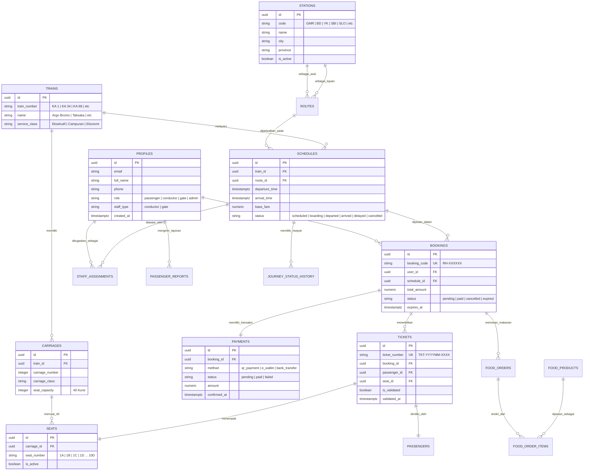

# 🚆 RAILHUB - Sistem Informasi Reservasi & Operasional Kereta Api Terpadu

[](https://nextjs.org/)
[](https://react.dev/)
[](https://supabase.com/)
[](https://railhub-indonesia.vercel.app)
[](https://developer.mozilla.org/en-US/docs/Web/JavaScript)
[](LICENSE)

**RAILHUB** adalah platform web *full-stack* modern berskala enterprise untuk simulasi reservasi tiket, manajemen perjalanan, dan kendali operasional terpadu jaringan kereta api antarkota di Pulau Jawa. Sistem ini mengintegrasikan seluruh siklus perjalanan kereta api-mulai dari pencarian jadwal multi-stasiun, pemilihan kursi interaktif 40-seat gerbong, pemesanan tiket atomik bebas *double-booking*, penerbitan *e-boarding pass* berbasis QR Code, *reschedule* dan pembatalan otomatis 2 jam sebelum keberangkatan, pemesanan makanan & minuman restorasi kereta (*onboard dining*), meja layanan bantuan & barang tertinggal, hingga sistem operasional dinas petugas kondektur dan panel *monitoring* administrator dengan sistem navigasi sidebar modern.

> 🌐 **Production URL:** [https://railhub-indonesia.vercel.app](https://railhub-indonesia.vercel.app)  
> 📌 *Catatan: Proyek ini merupakan simulasi komputasi berbasis data nyata jaringan perkeretaapian Indonesia untuk keperluan akademik dan pengujian sistem.*

---

## 📋 Daftar Isi
1. [Ringkasan Produk (Mini-PRD)](#1-ringkasan-produk-mini-prd)
2. [Arsitektur & Teknologi](#2-arsitektur--teknologi)
3. [Fitur Utama Berdasarkan Hak Akses (Role)](#3-fitur-utama-berdasarkan-hak-akses-role)
4. [Desain Database & ERD](#4-desain-database--erd)
5. [Implementasi Validasi 3 Lapis & Integritas Data](#5-implementasi-validasi-3-lapis--integritas-data)
6. [Prasyarat & Petunjuk Instalasi](#6-prasyarat--petunjuk-instalasi)
7. [Konfigurasi Environment (.env.example)](#7-konfigurasi-environment-envexample)
8. [Inisialisasi Database, Migrasi & Seeding](#8-inisialisasi-database-migrasi--seeding)
9. [Prosedur Pengujian & Verifikasi Kualitas](#9-prosedur-pengujian--verifikasi-kualitas)
10. [Akun Demo & Akses Cepat Pengujian](#10-akun-demo--akses-cepat-pengujian)

---

## 1. Ringkasan Produk (Mini-PRD)

### Latar Belakang Masalah
Pengelolaan tiket dan perjalanan kereta api melibatkan kompleksitas tinggi: volume penumpang yang besar, keterbatasan kuota kursi per gerbong, sinkronisasi jadwal real-time antarkota, kepatuhan batas waktu check-in, dan kebutuhan koordinasi awak kereta (kondektur dan petugas gate) dengan pusat kendali. Sistem konvensional sering menghadapi risiko pemesanan kursi ganda (*race condition double-booking*), kesulitan pelacakan status keterlambatan dinas KA, serta terbatasnya layanan tambahan bagi penumpang di dalam gerbong (seperti pemesanan restorasi dan pelaporan kendala perjalanan).

### Solusi & Tujuan
RAILHUB hadir sebagai solusi terpusat yang:
1. **Pencegahan Bentrok Kursi Mutlak (Anti Double-Booking):** Mengimplementasikan transaksi database atomik di level PostgreSQL dengan isolasi ketat sehingga dua pengguna yang memilih kursi sama dalam waktu bersamaan tidak akan pernah berhasil memesan secara duplikat.
2. **Katalog Terverifikasi 50+ Stasiun & Armada Nyata:** Menghubungkan koridor rel utama Pulau Jawa (DKI Jakarta, Jawa Barat, Jawa Tengah, DI Yogyakarta, Jawa Timur, dan Banten) menggunakan data riil armada legendaris (Argo Bromo Anggrek, Taksaka, Argo Parahyangan, Argo Wilis, Turangga).
3. **Penerbitan E-Boarding Pass & Validasi Lapangan 1-Tap:** Menghasilkan tiket digital dengan QR Code terenkripsi yang hanya dapat divalidasi satu kali oleh petugas gerbang/kondektur menggunakan kamera pemindai bawaan (*built-in webcam/mobile camera scanner*).
4. **Sistem Operasional Kondektur & Admin dengan Sidebar Modern:** Menggantikan layout tab konvensional dengan *Operational Dashboard Shell* berbasis navigasi sidebar desktop (270px) dan *mobile swipeable pill tabs* yang responsif.
5. **Kebijakan Fleksibilitas Penumpang (2 Jam Cutoff):** Memfasilitasi *reschedule* jadwal (denda selisih 20%) dan pembatalan tiket (pengembalian dana simulasi 80%) secara otomatis dengan batas waktu aman 2 jam sebelum jadwal keberangkatan.

---

## 2. Arsitektur & Teknologi

### Tech Stack Utama
- **Framework Full-Stack:** [Next.js 16.4.3](https://nextjs.org/) (App Router, Turbopack, Partial Prerendering / PPR, Cache Components)
- **Library UI & Reaktivitas:** [React 19](https://react.dev/), [Lucide React Icons](https://lucide.dev/)
- **Desain & Tipografi:** Custom Vanilla CSS Design System dengan CSS Variables (`#1A428A` Royal Blue, `#EA580C` Tangerine, `#059669` Emerald), Google Fonts Montserrat & Space Grotesk
- **Database & Autentikasi:** [PostgreSQL 15+](https://www.postgresql.org/) & [Supabase Auth](https://supabase.com/) (`@supabase/ssr`, `@supabase/supabase-js`, Row Level Security / RLS)
- **Pemindai & Barcode Engine:** `qrcode` (Pembuat QR tiket resolusi tinggi), `@zxing/browser` (Pemindai kamera QR code & barcode boarding pass)
- **Sintesis Audio Kereta:** Web Audio API (`AudioContext`) untuk membangkitkan melodi genta/chime kedatangan stasiun khas PT KAI secara prosedural tanpa ketergantungan file eksternal
- **Deployment & CI/CD:** [Vercel Production](https://vercel.com/) terintegrasi otomatis ke branch `main` GitHub

### Struktur Direktori Proyek
```text
c:\Projects\RAILHUB-1/
├── src/
│   ├── app/                              # Next.js App Router (Rute & Halaman)
│   │   ├── (public)/                     # Beranda, Jadwal KA (/trains), Tentang (/about), FAQ, Kontak
│   │   ├── api/schedules/reschedule/     # Endpoint generator jadwal prosedural harian real-time
│   │   ├── auth/                         # Autentikasi: Login, Register, OAuth Callback
│   │   ├── booking/[scheduleId]/         # Alur pemilihan gerbong/kursi & input data penumpang
│   │   ├── booking/payment/[bookingId]/  # Checkout pembayaran simulasi & tiket aktif
│   │   ├── dashboard/admin/              # Pusat kendali operasional Administrator Sistem
│   │   ├── dashboard/passenger/          # Portal Penumpang (Tiket, Reschedule, Refund, Riwayat)
│   │   ├── dashboard/staff/              # Portal Dinas Lapangan Petugas Gerbang & Kondektur
│   │   ├── globals.css                   # Core Design System, responsive breakpoints & themes
│   │   └── layout.js                     # Root Layout: Provider Auth, Lang, ConfirmModal, Toast
│   ├── components/                       # Komponen UI Reusable
│   │   ├── auth/                         # Ilustrasi vektor lokomotif mobile & chip login demo
│   │   ├── booking/                      # EBoardingPass, BookingPayment, Formasi Kursi 40-Seat
│   │   ├── home/                         # SearchWidget, PopularTicketRoutes, MobilePortalHeader
│   │   ├── layout/                       # Navbar, OperationalDashboardShell (Sidebar Navigation)
│   │   ├── payment/                      # Authentic Vector Logos: QRIS, E-Wallet, Bank VA
│   │   ├── services/                     # PassengerServices (Restorasi KA & Laporan Masalah)
│   │   ├── staff/                        # TicketScanner (Pemindai Kamera Live QR/Barcode)
│   │   └── ui/                           # LiveRoleClock, RailConfirmDialog, VectorLogos KAI
│   ├── contexts/                         # React Contexts (AuthContext, ConfirmDialogContext, LangContext)
│   └── lib/                              # Logika Bisnis & Utilitas Inti
│       ├── auth/roles.js                 # Role boundary isolator & sanitasi rute navigasi
│       ├── data/scheduleGenerator.js     # Generator jadwal dinamis prosedural real-time
│       ├── operations/journey-status.js  # Mesin transisi status perjalanan KA (State Machine)
│       ├── supabase/                     # Supabase Client, Server, & Middleware cookies helper
│       └── utils/formatters.js           # Formatter Rupiah, Tanggal Indonesia, Waktu WIB
├── supabase/
│   ├── migrations/                       # 20 File Migrasi SQL Berurutan (RLS, RPC, Constraints)
│   ├── schema.sql                        # Skema database relasional dasar
│   └── seed.sql                          # Data awal master stasiun, kereta, rute, gerbong, kursi
├── tests/
│   └── auth-roles.test.mjs               # Test suite otomatis isolasi peran pengguna & hak akses
├── DEPLOYMENT_GUIDE.md                   # SOP deployment GitHub multi-remote & Vercel
├── package.json
└── next.config.mjs
```

---

## 3. Fitur Utama Berdasarkan Hak Akses (Role)

| Peran (Role) | Fitur & Hak Akses Utama |
| :--- | :--- |
| **Publik (Tanpa Login)** | • **Pencarian Jadwal Cerdas:** Menemukan kereta antarkota berdasarkan stasiun asal, stasiun tujuan, tanggal, dan jumlah penumpang.<br>• **Filter & Urutan:** Penyaringan rute berdasarkan kelas (Eksekutif, Bisnis, Ekonomi), harga termurah, durasi tercepat, dan jam berangkat.<br>• **Rute Populer Tiket:** Tampilan kartu tiket minimalis dengan animasi geser (*continuous sliding*) di mobile dan coret harga promo (*strikethrough pricing*).<br>• **Katalog 50+ Stasiun & Armada:** Eksplorasi stasiun se-Pulau Jawa dan spesifikasi kereta api unggulan.<br>• **Akses Cepat Mobile:** Pintasan langsung ke Tentang Kami (`/about`), FAQ (`/faq`), Kontak CS 24/7 (`/contact`), dan Tiket Saya.<br>• **Multi-Bahasa (ID/EN):** Pengalihan bahasa sistem dengan dialog konfirmasi kustom bertema Globe RailHub. |
| **Penumpang (`passenger`)** | • **Autentikasi Aman:** Pendaftaran akun, login kredensial, Google OAuth, atau 1-Click Demo Login.<br>• **Peta Kursi Visual:** Memilih gerbong dan nomor kursi spesifik (formasi 40 kursi per gerbong) secara real-time.<br>• **Checkout Multi-Metode Resmi:** Pembayaran simulasi dengan logo asli Indonesia: QRIS (GPN), E-Wallet (GoPay, OVO, DANA, ShopeePay), dan Virtual Account (BCA, Mandiri, BNI, BRI).<br>• **E-Boarding Pass Dinamis:** Tiket ber-QR Code dengan hitung mundur boarding pass yang aktif 2 jam sebelum keberangkatan.<br>• **Reschedule & Pembatalan Otomatis:** Perubahan jadwal kereta (biaya 20%) dan pembatalan tiket (pengembalian 80%) secara mandiri maksimal 2 jam sebelum keberangkatan.<br>• **Layanan Restorasi Kereta:** Memesan hidangan kuliner khas kereta api langsung dari gerbong penumpang.<br>• **Meja Bantuan & Barang Tertinggal:** Melaporkan kendala fasilitas atau barang hilang ke awak dinas KA. |
| **Petugas Kereta (`conductor` & `gate`)** | • **Dashboard Tugas Dinas:** Ringkasan dinas aktif, total manifest, rasio boarding penumpang, pesanan makanan, dan instruksi dinas.<br>• **Validasi Tiket Kamera (Gate & Bordes):** Pemindai QR code tiket langsung menggunakan kamera ponsel/laptop serta input manual nomor tiket.<br>• **Anti Double-Validation:** Mencegah tiket yang sama dipakai berulang kali melalui validasi atomik satu arah.<br>• **Manifest Penumpang Real-Time:** Daftar lengkap penumpang per jadwal, status boarding, dan nomor identitas (NIK/ID Card).<br>• **Status Perjalanan KA:** Memperbarui status dinas (`Scheduled` → `Boarding` → `Departed` → `Arrived` → `Delayed` → `Cancelled`) beserta catatan stasiun yang disinkronkan ke layar penumpang.<br>• **Meja Layanan Awak Kereta:** Memproses antrean pesanan makanan dan merespon laporan bantuan penumpang. |
| **Administrator Sistem (`admin`)** | • **Pusat Kendali Operasional:** Pantauan metrik pendapatan simulasi, jadwal aktif, total stasiun, dan peringatan dini dinas kondektur yang belum terisi.<br>• **Katalog & Master Stasiun:** Tambah, edit, dan kelola stasiun di 6 provinsi Jawa.<br>• **Master Armada & Rute:** Konfigurasi nomor KA, nama lokomotif, kecepatan dinas, serta lintasan koridor rel.<br>• **Formasi Gerbong & Kursi:** Visualisasi 40 kursi per gerbong dan penentuan status kursi dinas/khusus.<br>• **Pemesanan & Rekapitulasi:** Audit transaksi booking, kode pembayaran, dan akun pengguna terdaftar.<br>• **Penugasan Petugas KA:** Menugaskan kondektur ke jadwal perjalanan KA yang aktif.<br>• **Pengumuman Sistem:** Menyiarkan protokol keselamatan dinas kepada seluruh awak operasional. |

---

## 4. Desain Database & ERD

### Entity-Relationship Diagram (ERD)



### Prosedur Tersimpan (RPC Functions) Utama di PostgreSQL
- `search_train_schedules(p_origin, p_dest, p_date, p_class, p_sort)`: Mengkueri jadwal kereta yang aktif, menghitung sisa ketersediaan kursi secara dinamis, dan mengurutkan berdasarkan kriteria penumpang.
- `create_atomic_booking(...)`: Membuat catatan pemesanan, mengunci kursi yang dipilih, memvalidasi ketersediaan secara konkuren, dan mencegah duplikasi kursi.
- `simulate_booking_payment(p_booking_id)`: Memvalidasi batas waktu kedaluwarsa pembayaran, mengubah status menjadi `paid`, menerbitkan tiket unik ber-QR code, dan mencatat konfirmasi transaksi.
- `select_booking_payment_method(p_booking_id, p_method)`: Menyimpan preferensi metode pembayaran resmi (`qr_payment`, `e_wallet`, `bank_transfer`).
- `reschedule_paid_booking(p_booking_id, p_new_schedule_id, p_seat_mappings)`: Mengganti jadwal tiket yang telah terbayar dengan kalkulasi biaya 20% selisih tarif dan batas waktu maksimal 2 jam sebelum keberangkatan.
- `cancel_paid_booking(p_booking_id)`: Membatalkan tiket terbayar secara atomik, mengosongkan kembali formasi kursi, dan mencatat pengembalian dana 80% (potongan denda 20%).
- `validate_boarding_ticket(p_ticket_number)`: Memverifikasi keaslian tiket, memastikan keberangkatan kereta sesuai stasiun dinas petugas, dan menandai `is_validated = true` agar tidak bisa dipakai kembali.
- `update_assigned_journey_status(p_schedule_id, p_status, p_note)`: Memperbarui fase perjalanan kereta api secara berurutan dan otomatis mendokumentasikan log ke `journey_status_history`.

---

## 5. Implementasi Validasi 3 Lapis & Integritas Data

RAILHUB menerapkan arsitektur pengamanan data berlapis untuk menjaga integritas transaksi pemesanan transportasi publik:

```
┌─────────────────────────────────────────────────────────────┐
│ 1. LAPISAN FRONTEND (Client React & Custom RailHub Modal)   │
│    • Sanitasi input stasiun asal != stasiun tujuan          │
│    • Batas penumpang dewasa (1-4 pax), format NIK / No. KTP │
│    • Tombol disable anti-double click saat proses mutating  │
│    • Dialog konfirmasi kustom bertema KAI (tanpa alert bawaan)│
└──────────────────────────────┬──────────────────────────────┘
                               │
                               ▼
┌─────────────────────────────────────────────────────────────┐
│ 2. LAPISAN BACKEND & ROUTE GUARD (Next.js Middleware & SSR)  │
│    • Isolasi Dashboard per role di `src/lib/auth/roles.js`  │
│    • Pencegahan akses cross-portal (Penumpang ↔ Petugas ↔ Admin)│
│    • Token session validation via Supabase SSR Cookies      │
│    • Sanitasi parameter query URL & proteksi redirect loop  │
└──────────────────────────────┬──────────────────────────────┘
                               │
                               ▼
┌─────────────────────────────────────────────────────────────┐
│ 3. LAPISAN DATABASE (PostgreSQL Constraints, RLS & RPC)      │
│    • Row Level Security (RLS) pada 15+ tabel operasional    │
│    • PRIMARY KEY, FOREIGN KEY ON DELETE RESTRICT            │
│    • UNIQUE CONSTRAINT pada `booking_code` & `ticket_number` │
│    • CHECK constraint status booking, pembayaran, & metode  │
│    • Transaksi atomik PL/pgSQL dengan rollback otomatis     │
└─────────────────────────────────────────────────────────────┘
```

1. **Lapisan 1 - Frontend (Client-Side Validation):**
   - Validasi interaktif pemesanan: stasiun keberangkatan dan tujuan tidak boleh sama, tanggal berangkat tidak boleh di masa lampau, data penumpang wajib mengisi nomor identitas 16 digit yang valid.
   - Mengganti seluruh 31 dialog bawaan browser (`window.alert`, `window.confirm`) dengan komponen kustom `RailConfirmDialog` dan `ConfirmDialogContext` yang konsisten dengan estetika RailHub.
2. **Lapisan 2 - Backend & Server Guard (Next.js Middleware):**
   - `src/middleware.js` dan `src/lib/auth/roles.js` secara ketat memverifikasi sesi dan hak akses akun:
     - Akun ber-role `admin` dilarang memasuki area pemesanan penumpang biasa, dan langsung diarahkan ke `/dashboard/admin`.
     - Akun ber-role `conductor` atau `gate` hanya dapat mengakses `/dashboard/staff`.
     - Penumpang dilarang mengakses panel kendali operasional dan ditolak dengan HTTP 307 redirect.
3. **Lapisan 3 - Database (PostgreSQL Constraints & RLS):**
   - Kebijakan RLS membatasi hak baca dan tulis: penumpang hanya dapat melihat data tiket dan pemesanan milik akunnya sendiri (`auth.uid() = user_id`).
   - Petugas kereta hanya diizinkan membaca manifest dan memvalidasi tiket pada jadwal yang ditugaskan kepada mereka di `staff_assignments`.
   - Transaksi pemesanan dan pembatalan dibungkus dalam blok atomik database untuk mencegah inkonsistensi saat terjadi kegagalan jaringan di tengah proses.

---

## 6. Prasyarat & Petunjuk Instalasi

### Prasyarat Sistem
- **Node.js** versi `18.18.0` atau lebih baru (sangat direkomendasikan Node.js v20 LTS atau v22).
- **npm** versi 9+ atau package manager sejenis (`pnpm`, `yarn`, `bun`).
- Akun dan proyek aktif di **[Supabase](https://supabase.com/)** (PostgreSQL Database & Auth).
- Browser modern dengan dukungan kamera (untuk pengujian fitur scanner QR Code tiket).

### Langkah Menjalankan Aplikasi Secara Lokal

1. **Clone repository ini ke komputer lokal:**
   ```bash
   git clone https://github.com/Bagaspermana0/railhub.git
   cd railhub
   ```

2. **Instal seluruh paket dependensi:**
   ```bash
   npm install
   ```

3. **Buat file environment lokal:**
   Salin contoh konfigurasi atau buat file bernama `.env.local` di root direktori proyek:
   ```bash
   cp .env.example .env.local
   ```
   Isi variabel sesuai kredensial Supabase Anda (lihat bagian [Konfigurasi Environment](#7-konfigurasi-environment-envexample)).

4. **Jalankan server pengembangan (Development Server):**
   ```bash
   npm run dev
   ```
   Aplikasi akan aktif di [http://localhost:3000](http://localhost:3000).

5. **Build dan jalankan versi produksi secara lokal:**
   ```bash
   npm run build
   npm run start
   ```

---

## 7. Konfigurasi Environment (`.env.example`)

Buat file bernama `.env.local` pada direktori root proyek. Jangan pernah meng-commit file `.env.local` atau kunci rahasia (*service role key*) ke dalam repositori Git publik.

```env
# ==============================================================================
# KONFIGURASI SUPABASE (WAJIB)
# ==============================================================================
# URL instance Supabase Anda (didapat dari Dashboard -> Settings -> API)
NEXT_PUBLIC_SUPABASE_URL=https://your-project-id.supabase.co

# Kunci Anonim Publik Supabase (aman diakses di sisi browser client)
NEXT_PUBLIC_SUPABASE_ANON_KEY=eyJhbGciOiJIUzI1NiIsInR5cCI6IkpXVCJ9...

# Kunci Rahasia Service Role Supabase (HANYA untuk skrip CLI / migrasi backend)
# PERINGATAN: JANGAN beri awalan NEXT_PUBLIC_ agar tidak bocor ke browser client!
SUPABASE_SERVICE_ROLE_KEY=your-supabase-service-role-secret-key

# ==============================================================================
# KONFIGURASI DOMAIN & APLIKASI
# ==============================================================================
# URL basis aplikasi (gunakan http://localhost:3000 saat pengujian lokal)
NEXT_PUBLIC_APP_URL=http://localhost:3000

# Nomor WhatsApp Resmi Customer Care RailHub untuk integrasi bantuan floating
NEXT_PUBLIC_WHATSAPP_NUMBER=6281234567890
```

---

## 8. Inisialisasi Database, Migrasi & Seeding

Struktur database RAILHUB dibangun melalui skema dasar dan 20 file migrasi modular yang tersimpan di direktori `supabase/migrations/`.

### Langkah Eksekusi SQL di Supabase SQL Editor:
1. Buka dashboard proyek Supabase Anda, lalu masuk ke menu **SQL Editor**.
2. Jalankan skema dasar: `supabase/schema.sql`.
3. Jalankan data master awal: `supabase/seed.sql` (mengisi data stasiun, rute, kereta, gerbong, 40 kursi per gerbong, dan produk menu restorasi).
4. Jalankan file migrasi secara berurutan sesuai timestamp nomor:
   - `202610310001_search_train_schedules.sql` - Pencarian jadwal & kalkulasi ketersediaan kursi.
   - `202610310002_secure_passenger_booking.sql` - Booking atomik dan penerbitan tiket ber-QR.
   - `202610310003_staff_operations.sql` - Penugasan staf dan verifikasi boarding tiket.
   - `202610310004_passenger_services.sql` - Menu restorasi dan laporan bantuan penumpang.
   - `202610310005_simulated_schedule_calendar.sql` s/d `202610310007_expand_simulated_schedule_calendar.sql` - Kalender jadwal dinas 90 hari.
   - `202611010001_ensure_40_seats_per_carriage.sql` - Standardisasi formasi 40 kursi gerbong.
   - `202611010002_manage_paid_bookings.sql` - Mesin reschedule dan pembatalan tiket.
   - `202611010003_food_order_checkout.sql` & `202611010004_ticket_payment_method.sql` - Rekam metode bayar resmi.
   - `202611010006_enable_simulated_payments.sql` - Otomasi status pembayaran simulasi.
   - `202611010007_expand_station_catalog.sql` - Katalog 50 stasiun koridor pulau Jawa.
   - `202611020001_staff_passenger_journey_flow.sql` - State machine status dinas perjalanan KA.
   - `20261104192451_role_station_access.sql` - Validasi stasiun penugasan gerbang/kondektur.
   - `20261105061114_remove_midtrans_and_harden_roles.sql` - Hardening isolasi role pengguna.
   - `20261105193000_reschedule_cancel_2hours.sql` - Enforce cutoff fleksibilitas 2 jam keberangkatan.

### Generator Jadwal Otomatis Real-Time (Procedural Reschedule)
Aplikasi dilengkapi dengan generator jadwal prosedural cerdas di `src/lib/data/scheduleGenerator.js` dan endpoint `/api/schedules/reschedule`. Setiap kali sistem dijalankan, generator akan memastikan tersedianya puluhan jadwal perjalanan aktif real-time untuk hari ini dan hari-hari berikutnya menggunakan kombinasi acak armada nyata dan koridor antarkota.

---

## 9. Prosedur Pengujian & Verifikasi Kualitas

RAILHUB dilengkapi dengan serangkaian pengujian otomatis untuk memvalidasi isolasi hak akses, sintaks kode, dan build produksi:

### 1. Pengujian Isolasi Peran & Hak Akses (Role Boundary Tests)
Memastikan akun penumpang tidak dapat mengakses panel admin/petugas, akun operasional diarahkan ke dashboard masing-masing, dan sanitasi pengalihan rute berjalan aman:
```bash
npm run test:roles
```
*Output Verifikasi:*
```text
✔ dashboard access is isolated by operational role (1.368ms)
✔ operational roles cannot enter the passenger portal (0.2323ms)
✔ post-login destinations are role-aware and boundary-safe (0.2694ms)
✔ resolves demo operational roles correctly even before DB sync (0.2157ms)
ℹ tests 4 | pass 4 | fail 0
```

### 2. Pemeriksaan Kualitas & Sintaks Kode (Linting)
Menjalankan ESLint untuk memastikan seluruh kode bersih dari error sintaks, entitas unescaped, atau dependency hook yang hilang:
```bash
npm run lint
```

### 3. Kompilasi Produksi (Production Build Test)
Menguji kompilasi seluruh halaman statis, dynamic server routes, dan partial prerendering menggunakan Turbopack:
```bash
npm run build
```

---

## 10. Akun Demo & Akses Cepat Pengujian

Untuk mempermudah pengujian alur kerja aplikasi tanpa perlu mendaftar email secara manual, halaman login (`/auth/login`) menyediakan **Micro-Chips 1-Click Demo Login**:

| Peran (Role) | Kredensial Email | Password Demo | Wilayah / Kereta Penugasan |
| :--- | :--- | :--- | :--- |
| **Penumpang** | `penumpang.demo@railhub.id` | `DemoPassenger2026!` | Pemesanan Tiket & Layanan Penumpang |
| **Administrator** | `admin.operasional@railhub.id` | `DemoAdmin2026!` | Pusat Kendali Seluruh Jaringan KA Jawa |
| **Kondektur KA 1** | `petugas.argobromo@railhub.id` | `DemoStaff2026!` | KA Argo Bromo Anggrek (GMR ↔ SBI) |
| **Kondektur KA 68** | `petugas.taksaka@railhub.id` | `DemoStaff2026!` | KA Taksaka (GMR ↔ YK) |
| **Kondektur KA 34** | `petugas.parahyangan@railhub.id` | `DemoStaff2026!` | KA Argo Parahyangan (GMR ↔ BD) |
| **Kondektur KA 6** | `petugas.argowilis@railhub.id` | `DemoStaff2026!` | KA Argo Wilis (BD ↔ SGU) |
| **Kondektur KA 66** | `petugas.turangga@railhub.id` | `DemoStaff2026!` | KA Turangga (BD ↔ SGU) |

---

## 📄 Lisensi & Hak Cipta
Dikembangkan sebagai proyek simulasi teknologi rekayasa web transportasi modern. Seluruh data stasiun, nama armada kereta, dan rute diadaptasi dari jaringan publik perkeretaapian Pulau Jawa untuk tujuan edukasi dan peragaan arsitektur perangkat lunak *full-stack*.
